# Wireshark Lab: Packet Filtering and Scan Analysis

This lab uses Wireshark display filters to analyze three capture files: a TCP connect scan, an Xmas scan, and a general capture containing DNS and TLS traffic.

| Part | Capture file | Focus |
|------|--------------|-------|
| 1a | `connect_scan.pcap` | Non-IP traffic, scanner identification, established connections |
| 1b | `xmas_scan.pcap` | Detecting an Xmas scan using TCP flags |
| 1c | `general_datalog.pcapng` | DNS and TLS filtering |

---

## Part 1a: `connect_scan.pcap`

### 1. Display all non-IP packets

Typing `ip` as the filter shows only IP packets, so the negation is used to isolate everything else.

**Filter:** `not ip`

**Result:** 2 packets displayed out of 3,355 captured.

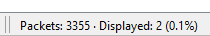

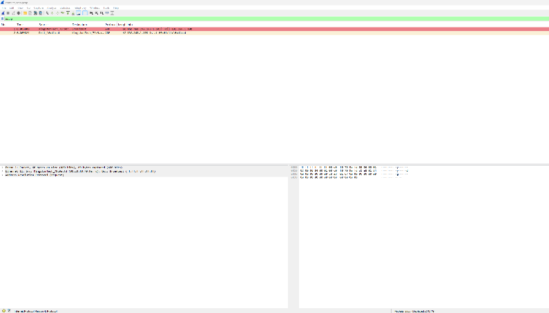

### 2. Display all packets from the scanner

A connect scan opens connections with SYN packets, so the scanner's probes have the SYN flag set and the ACK flag clear. These filters were built up step by step:

| Filter | Purpose |
|--------|---------|
| `tcp.flags.syn == 1` | All packets with SYN set |
| `tcp.flags.ack == 0` | All packets with ACK not set |
| `tcp.flags.syn == 1 and tcp.flags.ack == 0` | Initial SYN probes only (scanner to target) |

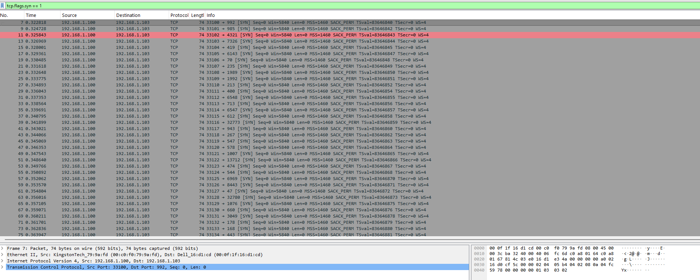

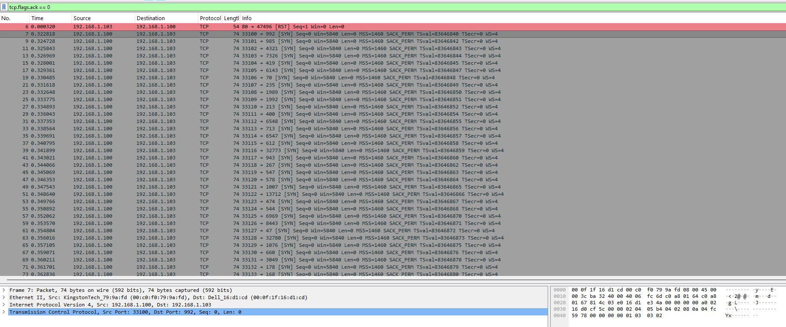

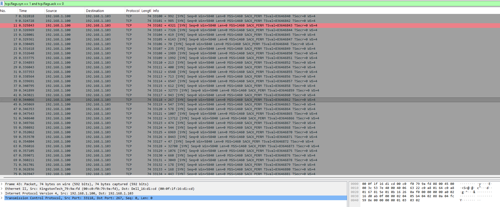

**Scanner IP address:** `192.168.1.100`

### 3. Display packets from successful (established) connections

An open port answers a SYN with a SYN/ACK. Filtering for SYN/ACK packets sent back to the scanner shows only the ports that accepted a connection.

**Filter:** `ip.dst == 192.168.1.100 and tcp.flags.syn == 1 and tcp.flags.ack == 1`

**Result:** 6 successful connections.

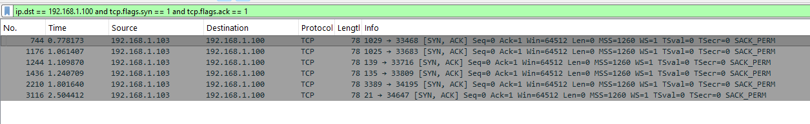

---

## Part 1b: `xmas_scan.pcap`

An Xmas scan sends TCP packets with the **FIN**, **PSH**, and **URG** flags set.

| Flag | Bit value |
|------|-----------|
| URG | 32 |
| PSH | 8 |
| FIN | 1 |
| **Total** | **41 (`0x29`, binary `00101001`)** |

**Filter:** `tcp.flags == 41`

**Why it works:** Using `==` against the whole flags field means only packets with *exactly* those three flags set will match. A filter such as `tcp.flags.fin == 1 and tcp.flags.push == 1 and tcp.flags.urg == 1` would also match packets that have additional flags set.

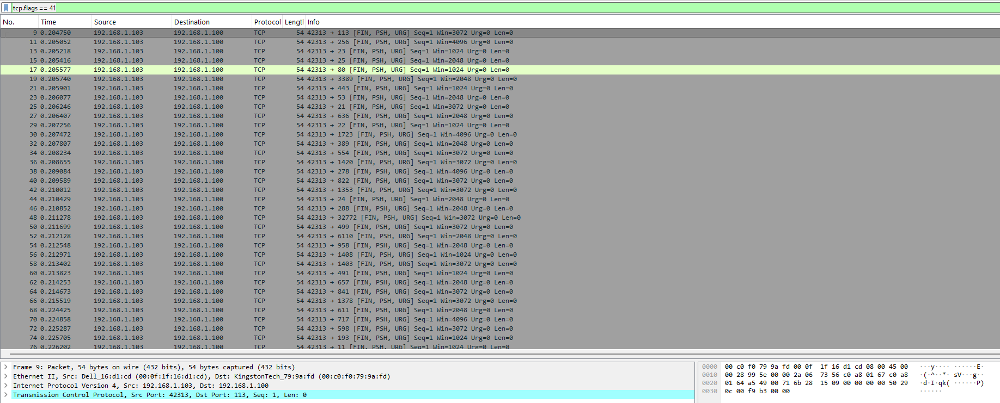

**Result:** 3,339 packets in the capture.

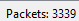

**Scanner IP address:** `192.168.1.103` (the source address of the packets matching `tcp.flags == 41`)

---

## Part 1c: `general_datalog.pcapng`

### 1. Display all DNS packets

**Filter:** `dns`

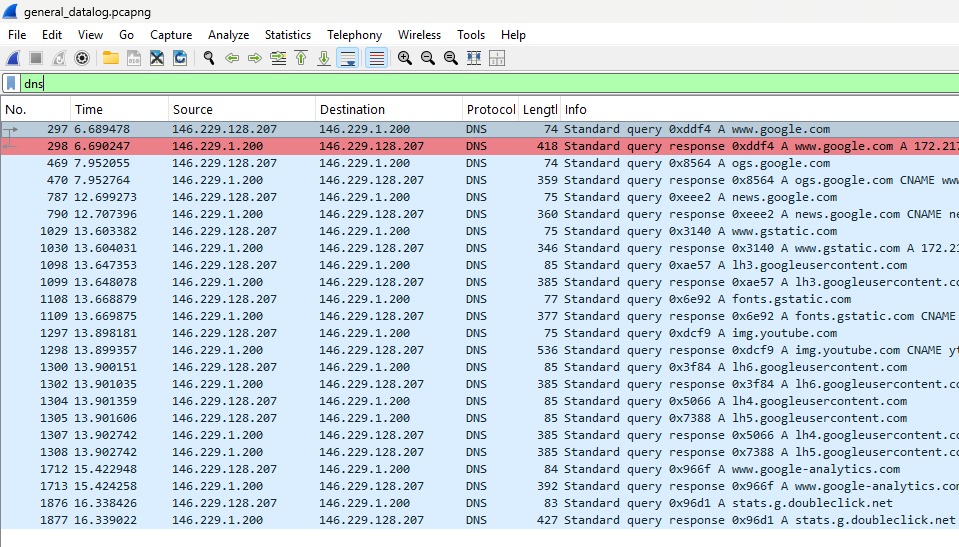

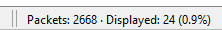

**Result:** 24 DNS packets displayed out of 2,668 captured.

### 2. Display only DNS responses

**Filter:** `dns.flags.response == 1`

**Result:** 12 responses.

### 3. Find the gstatic.com server

**Filter:** `dns.qry.name contains "gstatic.com" and dns.flags.response == 1`

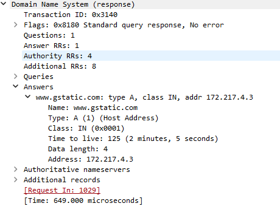

- **IP address of the gstatic.com server:** `172.217.4.3`
- **Registered owner address (Google):** 1600 Amphitheatre Parkway, Mountain View, CA 94043

### 4. Display TLS packets by version

The `ssl` / `tls` filter family covers many SSL and TLS versions. TLS 1.2 uses the record version `0x0303`.

**Filter:** `tls.record.version == 0x0303`

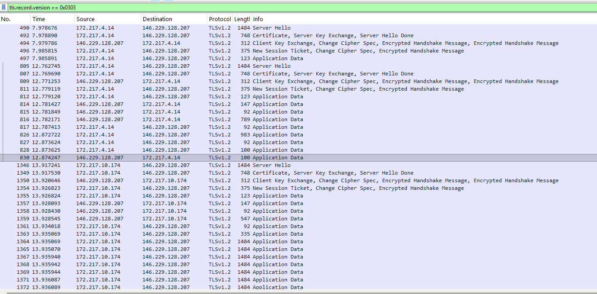

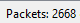

**Result:** The matching traffic is TLSv1.2 between `146.229.128.207` and Google servers (`172.217.4.14`, `172.217.10.174`), including Server Hello, Certificate, Key Exchange, and Application Data records.

---

## Summary of Filters

| Task | Filter |
|------|--------|
| Non-IP packets | `not ip` |
| Scanner SYN probes | `tcp.flags.syn == 1 and tcp.flags.ack == 0` |
| Established connections | `ip.dst == 192.168.1.100 and tcp.flags.syn == 1 and tcp.flags.ack == 1` |
| Xmas scan packets | `tcp.flags == 41` |
| All DNS | `dns` |
| DNS responses | `dns.flags.response == 1` |
| gstatic.com response | `dns.qry.name contains "gstatic.com" and dns.flags.response == 1` |
| TLS 1.2 | `tls.record.version == 0x0303` |

## Key Takeaways

- Display filters can combine flag checks to fingerprint different scan types (connect scan: SYN without ACK; Xmas scan: FIN+PSH+URG).
- SYN/ACK replies identify open ports on the target.
- Matching `tcp.flags` with `==` requires an exact flag combination, while checking individual flag fields allows extra flags.
- Protocol names (`dns`, `tls`) are the quickest way to isolate a protocol's traffic.
